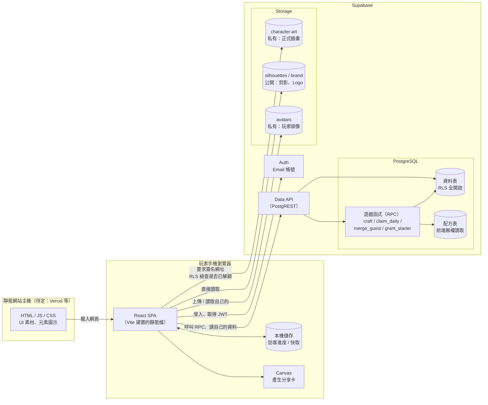
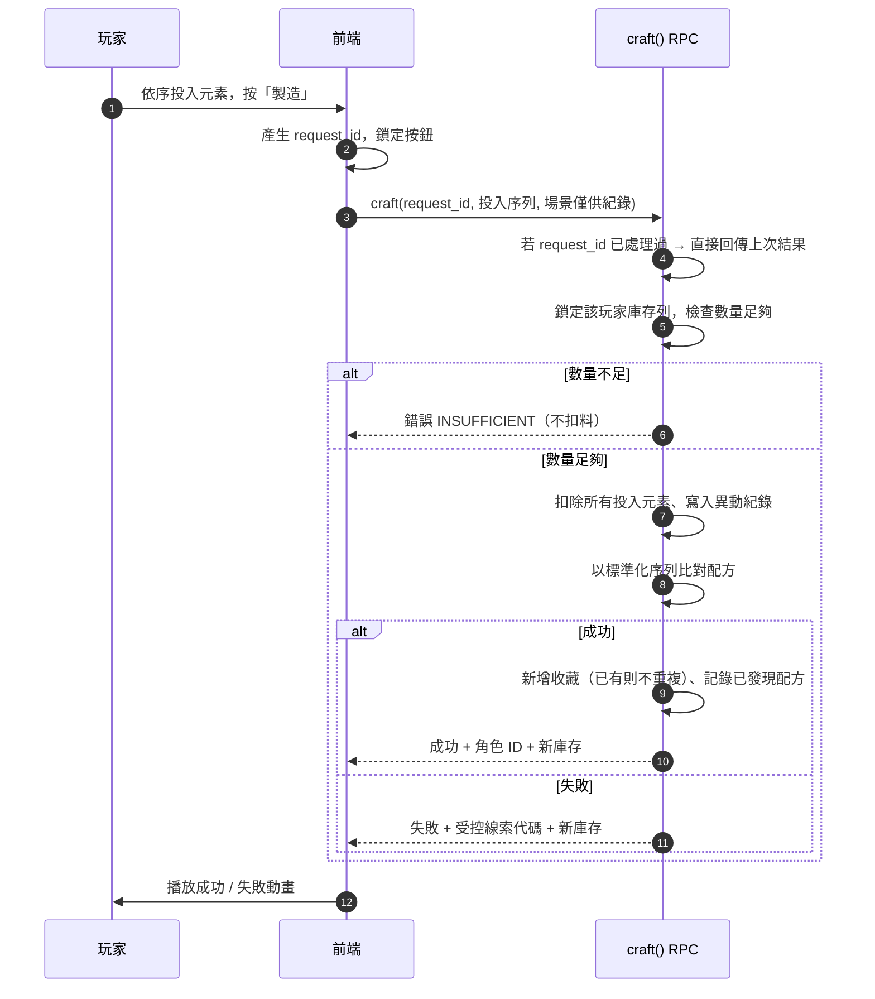
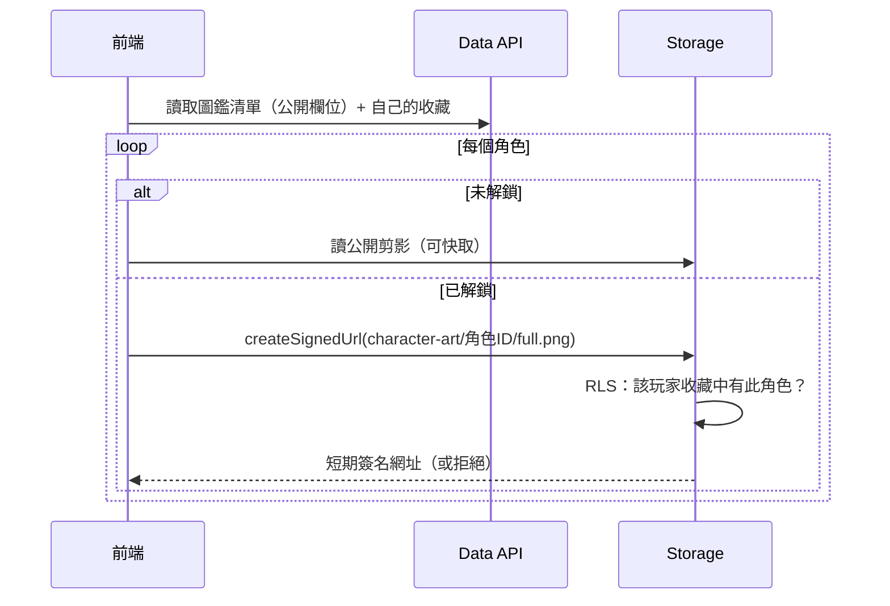
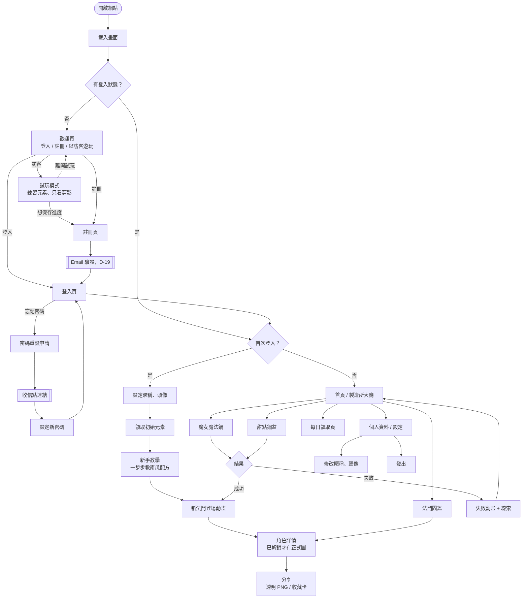

# 02｜系統架構圖與頁面流程圖

> 圖表使用 Mermaid 語法，在 GitHub 上會自動顯示成圖。

## 1. 技術選型與版本確認（2026-10 查核）

| 技術 | 建議 | 查核結果與注意事項 |
|---|---|---|
| Node.js | **24 LTS** | 24 目前為 Active LTS，維護至 2028-04；26 預計 2026-10 下旬進入 LTS。新手建議先用 24，Phase 1 開工時若 26 已 LTS 且 Vite 支援，可改用 26。 |
| 建置工具 | **Vite 8** | 2026-03 正式發布，改用 Rolldown 打包。實際版本以 `npm create vite@latest` 產生的為準，不手動指定。 |
| 前端框架 | **React + TypeScript** | 使用 Vite 官方 `react-ts` 範本，版本跟隨範本。 |
| 帳號 | **Supabase Auth** | Email／密碼、密碼重設信。免費方案寄信量有限，正式上線前需設定自訂 SMTP（D-19）。 |
| 資料庫 | **Supabase PostgreSQL** | 所有玩家寫入只透過資料庫函式（RPC）執行，用交易保證扣料、領取、合併的正確性。 |
| 檔案 | **Supabase Storage** | 正式插畫放私有 bucket，以 Storage RLS 檢查解鎖狀態後才能取得簽名網址。 |
| 版本控制 | **Git + GitHub** | 資料庫結構用 migration 檔案管理並進版控。 |
| 部署 | **待決定**（D-18） | 你現有的寄賣平台用 Vercel，可沿用；靜態網站也可用 Netlify、Cloudflare Pages。 |

### Supabase 服務限制（需留意）

- **免費專案 7 天無活動會暫停**，資料保留但網站連不上，需到後台手動恢復。開發期可接受；正式上線建議付費方案。
- 免費方案的資料庫、Storage、流量都有額度（第三方來源數字不一，以 Supabase 官方 pricing 頁為準）。5～10 張 PNG 與少量測試玩家遠低於額度。
- **2026-10-30 起既有專案新表需明確 GRANT** 才能被 supabase-js 存取。本設計已改為「預設不開放、逐表授權」，反而更安全。

> 以上版本與限制資料查核日期為 2026-10-24。

## 2. 系統架構圖

### 關鍵原則

1. **前端不保存任何配方答案**。配方表只有資料庫函式能讀，前端沒有 `SELECT` 權限。
2. **玩家資料表前端只能讀自己的，不能直接寫**。所有加減元素、新增收藏都經由 RPC，在單一交易內完成。
3. **每個寫入 RPC 都帶 `request_id`（前端產生的 UUID）**，伺服器以唯一約束防止重複提交。
4. **日期由伺服器決定**。每日領取用伺服器時間加上設定的時區與重置時間計算，不信任手機時間。
5. **正式插畫只能用短期簽名網址讀取**，簽名前由 Storage RLS 檢查該玩家是否擁有該角色。

## 3. 資料流

### 3.1 製造（已登入）

### 3.2 圖鑑讀圖

## 4. 頁面流程圖

## 5. 前端模組規劃（Phase 1 參考，不是程式碼）

| 模組 | 責任 |
|---|---|
| `auth` | 登入狀態、註冊、登入、登出、密碼重設 |
| `progress` | 讀寫雲端進度（只有登入玩家有進度） |
| `workshop` | 兩種場景畫面（可隨時切換，純外觀）、投入序列編輯、送出製造 |
| `dex` | 圖鑑清單、剪影／正式圖切換、簽名網址快取 |
| `daily` | 每日領取狀態與領取 |
| `trial` | 訪客試玩：練習元素、投料動畫，不連線、不保存 |
| `share` | Canvas 合成收藏卡、匯出 PNG |
| `config` | 從資料庫讀取可調整設定（元素清單、上限等公開設定） |
