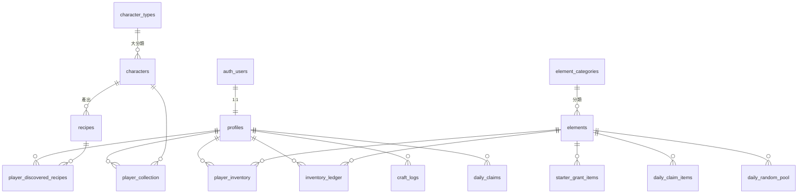

# 03｜資料庫關聯、欄位、主鍵、外鍵與 RLS 權限規劃

> 這是**設計文件**，不是可執行的 migration。Phase 1/2 才會依此撰寫 SQL。
> 欄位型別使用 PostgreSQL 型別。`‹TBD›` 表示由待決策項目決定。

## 1. 資料表分類

| 類別 | 資料表 | 誰能讀 | 誰能寫 |
|---|---|---|---|
| 遊戲主資料（公開） | `element_categories`、`elements`、`scenes`、`character_types`、`characters` | 所有人（只開放安全欄位） | 只有管理者（migration / 後台） |
| 遊戲主資料（機密） | `recipes`、`fail_hints` | **前端不可讀**，只有 RPC | 只有管理者 |
| 可調整設定 | `game_settings`、`starter_grant_items`、`daily_claim_items`、`daily_random_pool` | 公開設定可讀 | 只有管理者 |
| 玩家資料 | `profiles`、`player_inventory`、`player_collection`、`player_discovered_recipes` | 本人 | `profiles` 部分欄位本人可改；其餘只能透過 RPC |
| 紀錄 | `inventory_ledger`、`craft_logs`、`daily_claims` | 本人（唯讀） | 只能透過 RPC |

## 2. 關聯圖

## 3. 資料表定義

### 3.1 遊戲主資料

**`element_categories`**

| 欄位 | 型別 | 約束 | 說明 |
|---|---|---|---|
| `id` | `text` | PK | 顏色系，例：`white`、`cream`、`amber`（清單見 `content/element_categories.csv`） |
| `name_zh` | `text` | NOT NULL | 顯示名稱，例：白色系 |
| `symbol_color` | `text` | NOT NULL，CHECK `^#[0-9A-F]{6}$` | 代表色；Phase 1 暫代圖示使用 |
| `sort_order` | `int` | NOT NULL DEFAULT 0 | |

**`elements`**

| 欄位 | 型別 | 約束 | 說明 |
|---|---|---|---|
| `id` | `text` | PK，格式 `^[a-z][a-z0-9_]{1,31}$` | 固定不變的元素 ID |
| `category_id` | `text` | FK → `element_categories.id`，NOT NULL | |
| `name_zh` | `text` | NOT NULL | |
| `icon_path` | `text` | NOT NULL | 公開素材路徑 |
| `max_stack` | `int` | NOT NULL，CHECK `> 0` | 持有上限 ‹TBD D-02› |
| `is_active` | `bool` | NOT NULL DEFAULT true | 停用不刪除，避免舊紀錄失去參照 |
| `sort_order` | `int` | NOT NULL DEFAULT 0 | |

**`scenes`**

| 欄位 | 型別 | 約束 | 說明 |
|---|---|---|---|
| `id` | `text` | PK | `cauldron`（魔女魔法鍋）、`dessert_bowl`（甜點鋼盆） |
| `name_zh` | `text` | NOT NULL | |
| `sort_order` | `int` | NOT NULL DEFAULT 0 | |

場景**只影響畫面外觀**（D-07），不參與配方比對、扣料或任何結果。

**`character_types`**（角色大分類）

| 欄位 | 型別 | 約束 | 說明 |
|---|---|---|---|
| `id` | `text` | PK | `cream`、`pied`、`blue`、`black_mask`、`amber`、`special`… |
| `name_zh` | `text` | NOT NULL | 奶油法鬥、乳牛法鬥… |
| `is_special` | `bool` | NOT NULL DEFAULT false | |
| `sort_order` | `int` | NOT NULL DEFAULT 0 | |

**`characters`**

| 欄位 | 型別 | 約束 | 說明 |
|---|---|---|---|
| `id` | `text` | PK，格式 `^fm[0-9]{3}$`（建議，見 08） | 固定且唯一，永不重用 |
| `dex_no` | `smallint` | UNIQUE，NOT NULL，CHECK `between 1 and 100` | 圖鑑編號，畫面顯示為 `001` |
| `name_zh` | `text` | NOT NULL | 是否對未解鎖者公開 ‹TBD D-10› |
| `type_id` | `text` | FK → `character_types.id`，NOT NULL | 大分類 |
| `base_type_id` | `text` | FK → `character_types.id`，NULL | 特殊法鬥的原本毛色（例：熱狗＝黑嘴） |
| `silhouette_path` | `text` | NOT NULL | 公開 bucket 中的剪影路徑 |
| `art_path` | `text` | NOT NULL | 私有 bucket 中的路徑（**不對前端公開此欄**） |
| `rarity` | `smallint` | NULL | 預留，第一版不顯示、不使用 |
| `is_released` | `bool` | NOT NULL DEFAULT false | 未發布的角色不出現在圖鑑 |

**`recipes`（機密）**

| 欄位 | 型別 | 約束 | 說明 |
|---|---|---|---|
| `id` | `text` | PK | 例：`r_fm001_a` |
| `character_id` | `text` | FK → `characters.id`，NOT NULL | |
| `steps` | `jsonb` | NOT NULL | 格式見 [04](04-data-formats.md) |
| `match_key` | `text` | NOT NULL | 由 `steps` 展開的格位字串，例 `potato\|@cream\|pumpkin\|pumpkin` |
| `version` | `int` | NOT NULL DEFAULT 1 | 配方調整時遞增 |
| `is_active` | `bool` | NOT NULL DEFAULT true | |
| — | — | UNIQUE (`match_key`) WHERE `is_active` | 不能有兩個相同配方 |
| — | — | UNIQUE (`character_id`) WHERE `is_active` | 每隻角色一個配方（D-07） |
| — | — | CHECK：`steps` 至少一步為 `{"element":"potato"}` | 馬鈴薯規則（實作為函式檢查） |

**`fail_hints`（機密）**

| 欄位 | 型別 | 約束 | 說明 |
|---|---|---|---|
| `code` | `text` | PK | 例：`ORDER_CLOSE`、`WRONG_ELEMENTS` |
| `message_zh` | `text` | NOT NULL | 顯示給玩家的文字 ‹TBD D-11› |

### 3.2 可調整設定

**`game_settings`**（單列設定表）

| 欄位 | 型別 | 說明 |
|---|---|---|
| `id` | `bool` PK DEFAULT true CHECK (`id`) | 強制只有一列 |
| `daily_reset_timezone` | `text` NOT NULL | `Asia/Taipei`（D-05） |
| `daily_reset_hour` | `smallint` NOT NULL CHECK `0..23` | `5`（D-05） |
| `daily_random_count` | `smallint` NOT NULL | 每日隨機抽取次數，`4`（D-04） |
| `tutorial_recipe_id` | `text` FK → `recipes.id` | 新手教學配方（暫定 `r_fm005_a`）；只有教學流程會把這個配方告訴玩家 |
| `overflow_policy` | `text` NOT NULL | 超過上限的處理方式 ‹TBD D-02› |
| `max_inputs` | `smallint` NOT NULL | 單次投入上限（兩場景相同）‹TBD D-08› |
| `updated_at` | `timestamptz` | |

**`starter_grant_items`**、**`daily_claim_items`**（結構相同；`daily_claim_items` 是每天保證發放的部分，例：馬鈴薯 2）

| 欄位 | 型別 | 約束 |
|---|---|---|
| `element_id` | `text` | PK，FK → `elements.id` |
| `quantity` | `int` | NOT NULL CHECK `> 0` |

**`daily_random_pool`**（每日隨機池，D-04）

| 欄位 | 型別 | 約束 |
|---|---|---|
| `element_id` | `text` | PK，FK → `elements.id` |
| `weight` | `int` | NOT NULL CHECK `> 0`（目前全部為 1） |

> 把數量放在資料表而不是程式碼裡，調整數值只需改資料，不需改前端或重新部署。

### 3.3 玩家資料

**`profiles`**

| 欄位 | 型別 | 約束 | 說明 |
|---|---|---|---|
| `user_id` | `uuid` | PK，FK → `auth.users.id` ON DELETE CASCADE | |
| `nickname` | `text` | NOT NULL，CHECK 長度 1～‹TBD› | |
| `avatar_path` | `text` | NULL | `avatars/{user_id}/...` |
| `starter_granted_at` | `timestamptz` | NULL | 非空代表已領過初始元素（防重複） |
| `tutorial_done_at` | `timestamptz` | NULL | 非空代表已完成新手教學 |
| `created_at`、`updated_at` | `timestamptz` | | |

**`player_inventory`**

| 欄位 | 型別 | 約束 |
|---|---|---|
| `user_id` | `uuid` | FK → `profiles.user_id` ON DELETE CASCADE |
| `element_id` | `text` | FK → `elements.id` |
| `quantity` | `int` | NOT NULL CHECK `quantity >= 0` |
| — | — | **PK (`user_id`, `element_id`)** |

上限檢查不放 CHECK（上限可調整，會讓舊資料違反約束），改由 RPC 在寫入時以 `least(新值, max_stack)` 套用。

**`player_collection`**

| 欄位 | 型別 | 約束 | 說明 |
|---|---|---|---|
| `user_id` | `uuid` | FK → `profiles` ON DELETE CASCADE | |
| `character_id` | `text` | FK → `characters.id` | |
| `first_unlocked_at` | `timestamptz` | NOT NULL | |
| `source` | `text` | CHECK in (`craft`, `admin`) | |
| `craft_count` | `int` | NOT NULL DEFAULT 1 | 重複製造時是否累計 ‹TBD D-09› |
| — | — | **PK (`user_id`, `character_id`)** | 主鍵保證收藏不重複 |

**`player_discovered_recipes`**：PK (`user_id`, `recipe_id`)，另有 `discovered_at`。

### 3.4 紀錄與冪等

**`inventory_ledger`**（所有元素增減的流水帳，用於除錯與客服）

| 欄位 | 型別 | 說明 |
|---|---|---|
| `id` | `bigint` identity PK | |
| `user_id` | `uuid` FK | |
| `element_id` | `text` FK | |
| `delta` | `int` NOT NULL | 正數增加，負數扣除 |
| `overflow` | `int` NOT NULL DEFAULT 0 | 因上限而未入帳的數量 |
| `reason` | `text` CHECK in (`starter`,`daily`,`craft`,`admin`) | |
| `ref_id` | `text` | 對應 `craft_logs.request_id` 等 |
| `created_at` | `timestamptz` | |

**`craft_logs`**

| 欄位 | 型別 | 約束 |
|---|---|---|
| `id` | `bigint` identity | PK |
| `user_id` | `uuid` | FK |
| `request_id` | `uuid` | **UNIQUE (`user_id`, `request_id`)** → 防重複提交 |
| `scene_id` | `text` | FK，僅記錄玩家當時使用的場景（統計用，不影響結果） |
| `inputs` | `jsonb` | 玩家投入的原始序列 |
| `success` | `bool` | |
| `character_id` | `text` | NULL（失敗時） |
| `recipe_id` | `text` | NULL |
| `hint_code` | `text` | NULL |
| `created_at` | `timestamptz` | |

**`daily_claims`**

| 欄位 | 型別 | 約束 |
|---|---|---|
| `user_id` | `uuid` | FK |
| `claim_day` | `date` | 伺服器依時區與重置時間算出的「遊戲日」 |
| `items` | `jsonb` | 實際發放內容（含被上限截掉的數量） |
| `claimed_at` | `timestamptz` | |
| — | — | **PK (`user_id`, `claim_day`)** → 同一遊戲日只能一列 |

## 4. 資料庫函式（RPC）

全部為 `SECURITY DEFINER`、固定 `search_path`、函式內以 `auth.uid()` 取得玩家，**不接受前端傳入 user_id**。

| 函式 | 參數 | 行為重點 |
|---|---|---|
| `ensure_profile(nickname)` | | 首次登入建立 profile |
| `grant_starter()` | | `starter_granted_at` 為空才發放，發放後設為 now()；同交易 |
| `claim_daily()` | | 計算遊戲日 → `INSERT ... ON CONFLICT DO NOTHING` 進 `daily_claims`；沒插入成功代表已領過 |
| `craft(request_id, inputs, scene_id)` | | 見 02 的時序圖；`SELECT ... FOR UPDATE` 鎖庫存 |
| `get_dex()` | | 回傳圖鑑清單；未解鎖角色依 D-10 隱藏名稱 |

## 5. 權限設計（GRANT + RLS）

Supabase 有兩層權限：**GRANT 決定角色能否碰這張表，RLS 決定能看到哪些列**。本專案兩層都要設。

### 5.1 基本原則

1. 每張 `public` 表一律 `ENABLE ROW LEVEL SECURITY`。
2. 先 `REVOKE ALL ... FROM anon, authenticated`，再逐表、逐欄位授權（符合 2026-10-30 起 Supabase 的新預設）。
3. 前端（`anon`、`authenticated`）**沒有任何玩家表的 INSERT / UPDATE / DELETE 權限**，唯一例外是 `profiles` 的 `nickname`、`avatar_path` 欄位。
4. `service_role` 金鑰**永不放進前端**，只用於管理腳本（如圖片匯入）。

### 5.2 權限矩陣

| 資料表 | anon | authenticated | RLS 條件 |
|---|---|---|---|
| `element_categories`、`elements`、`scenes`、`character_types` | SELECT | SELECT | `is_active`（如有） |
| `characters` | SELECT（限 `id, dex_no, silhouette_path` 等安全欄位，以欄位 GRANT 限制） | 同左 | `is_released` |
| `recipes`、`fail_hints` | ✗ | ✗ | 無 policy＝全拒 |
| `game_settings` | SELECT 公開欄位 | SELECT 公開欄位 | — |
| `starter_grant_items`、`daily_claim_items`、`daily_random_pool` | ✗（每日內容不預告） | ✗ | — |
| `profiles` | ✗ | SELECT、UPDATE(`nickname`,`avatar_path`) | `user_id = auth.uid()` |
| `player_inventory`、`player_collection`、`player_discovered_recipes` | ✗ | SELECT | `user_id = auth.uid()` |
| `inventory_ledger`、`craft_logs`、`daily_claims` | ✗ | SELECT | `user_id = auth.uid()` |
| RPC 函式 | ✗（D-12：訪客只能試玩，不呼叫任何遊戲函式） | EXECUTE | 函式內自行檢查 |

### 5.3 Storage 權限（細節見 [07](07-private-images.md)）

| Bucket | 公開 | 讀取 | 寫入 |
|---|---|---|---|
| `character-art` | 否 | authenticated 且 `player_collection` 有此角色 | 只有 service_role |
| `silhouettes` | 是 | 所有人 | 只有 service_role |
| `brand` | 是 | 所有人 | 只有 service_role |
| `avatars` | 否 | 本人資料夾 | 本人資料夾，限檔案類型與大小 ‹TBD D-15› |

## 6. 上線前權限自我檢查（Phase 2 驗收用）

- [ ] 以 anon key 查詢 `recipes` → 回傳錯誤或空集合。
- [ ] 以 A 玩家登入查詢 B 玩家的 `player_inventory` → 空集合。
- [ ] 以 authenticated 直接 `UPDATE player_inventory` → 權限錯誤。
- [ ] 以 authenticated 查詢 `characters.art_path` → 權限錯誤。
- [ ] Supabase 後台 Security Advisor 無警告。
