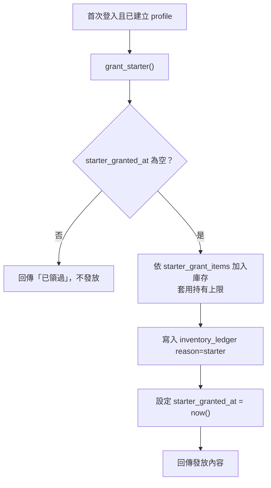

# 05｜初始元素與每日領取規則

## 1. 初始元素

### 已確認

- 新玩家依「測試法鬥配方」獲得初始元素。
- 元素種類由選定的測試配方決定。
- 初始元素必須足以完成**至少一個**配方，玩家才能開始遊玩。
- 數量放在 `starter_grant_items` 資料表，可調整，不寫死在畫面程式。

### 發放機制（設計）



整個流程在單一交易中完成，連按兩次也只會發一次。

### 設定時的自動檢查（Phase 2 建議實作）

匯入或修改 `starter_grant_items` 時，檢查腳本應確認：

- [ ] 至少有一個啟用配方，其所需元素全部能被初始元素滿足。
- [ ] 因為每個配方都需要馬鈴薯，初始元素必須包含馬鈴薯（數量待 D-03）。
- [ ] 每項初始數量不超過該元素的 `max_stack`。
- [ ] 列出「只靠初始元素可完成的配方」清單給你確認。

### 待決策

| 編號 | 問題 | 選項 |
|---|---|---|
| D-03 | 初始元素方案 | ✅ **B. 三隻＋容錯**（`content/starter_grant.csv`） |
| D-33 | 新手第一次製造的引導 | ✅ **A. 教學直接教一個配方**，暫定南瓜 |

### 新手教學流程（D-33）

1. 首次登入 → 設定暱稱 → 領取 21 個初始元素。
2. 教學畫面逐步提示：馬鈴薯 → 任一奶油色系（順便教「分類」的概念）→ 南瓜 ×2。
3. 教學期間只允許投入提示的元素，避免誤投浪費；送出時仍由伺服器正常驗證、扣料。
4. 成功 → 南瓜（fm005）正式解鎖，設定 `tutorial_done_at`。
5. 教學後剩下：馬鈴薯 4、奶油 1、牛奶 4、黑芝麻 2、藍莓 2、草莓 2、生菜 2，足夠做乳牛藍衣與花朵，再加 1～2 次失敗容錯。
6. 中途離開：下次登入從教學繼續，不會重複發放初始元素。

### 初始元素建議表（D-03）

依已確認的 5 個配方計算。每個配方所需：

| 角色 | 需要 |
|---|---|
| 南瓜 | 馬鈴薯 1、奶油色系 1（奶油或馬鈴薯）、南瓜 2 |
| 乳牛藍衣 | 馬鈴薯 1、牛奶 2、黑芝麻 1、藍莓 1 |
| 花朵 | 馬鈴薯 1、牛奶 1、草莓 2、生菜 1 |
| 熱狗 | 馬鈴薯 1、花生 2、海苔 1、番茄 1、生菜 1 |
| 螃蟹 | 馬鈴薯 1、牛奶 2、黑芝麻 1、番茄 2 |

三種方案：

| 元素 | A. 剛好一隻 | B. 三隻＋容錯（建議） | C. 五隻全包 |
|---|---|---|---|
| 馬鈴薯 | 2 | 5 | 5 |
| 奶油 | — | 2 | 1 |
| 南瓜 | 2 | 2 | 2 |
| 牛奶 | — | 4 | 5 |
| 黑芝麻 | — | 2 | 2 |
| 藍莓 | — | 2 | 1 |
| 草莓 | — | 2 | 2 |
| 生菜 | — | 2 | 2 |
| 花生 | — | — | 2 |
| 海苔 | — | — | 1 |
| 番茄 | — | — | 3 |
| **總數** | **4** | **21** | **26** |
| 可完成 | 南瓜 | 南瓜、乳牛藍衣、花朵 | 全部 5 隻各一次 |
| 容錯 | 無（一失敗就要等每日補給） | 約 1～2 次失敗 | 無 |
| 注意 | 給的元素等於直接告訴玩家答案 | 有多餘元素，不會直接洩漏答案 | 一次給太多，前期收集感較弱 |

數字都是建議，可以直接改。每項都不能超過該元素的持有上限（D-02）。

## 2. 每日領取

### 已確認

- 每天一次，簡易領取頁。
- 由伺服器判定資格並記錄。
- 同一天重複點擊不能重複領取。
- 不設體力。

### 「遊戲日」計算方式（設計）

```
遊戲日 = date( 伺服器現在時間 轉換到 daily_reset_timezone − daily_reset_hour 小時 )
```

示範：時區 `Asia/Taipei`、重置時間 5 點 → 台灣時間 11/2 04:59 仍算 11/1，05:00 起算 11/2。（已確認，D-05。）

`daily_claims` 以 (`user_id`, `claim_day`) 為主鍵，`INSERT ... ON CONFLICT DO NOTHING`；沒有插入成功即代表今日已領，資料庫層面保證不會重複。

### 領取頁顯示狀態

| 狀態 | 畫面 |
|---|---|
| 今日可領 | 顯示領取按鈕（內容不預告，領取後揭曉） |
| 處理中 | 按鈕停用、顯示讀取中 |
| 已領取 | 顯示「明天 ‹重置時間› 再來」與倒數 |
| 部分超過上限 | 依 D-02 顯示被捨棄或暫存的數量 |
| 離線 | 提示需要連線才能領取 |

### 待決策

| 編號 | 問題 | 選項 |
|---|---|---|
| D-04 | 每日補給 | ✅ 馬鈴薯 2（保證）＋ 隨機池抽 4 個（可重複、權重相同）＝ 6 個（`content/daily_claim.csv`） |
| D-04c | 預告 | ✅ 領取後才揭曉 |
| D-04d | 補領 | ✅ 錯過不補 |
| D-05 | 重置 | ✅ 台灣時間 05:00（`Asia/Taipei`） |

隨機抽取由 `claim_daily()` 在伺服器端執行，結果寫入 `daily_claims.items`；同一遊戲日重複呼叫直接回傳已抽出的結果，不會重抽。

## 3. 持有上限（初始、每日共用）

所有入帳都使用同一條規則：`入帳後數量 = min(原數量 + 增加量, max_stack)`，被截掉的部分記在 `inventory_ledger.overflow`。

超出部分的處理方式（D-02）：

| 選項 | 說明 | 優點 | 缺點 |
|---|---|---|---|
| A. 直接捨棄 | 超出就消失，預覽畫面先告知 | 最簡單、規則清楚 | 玩家可能覺得浪費 |
| B. 暫存信箱 | 放進「待領取」區，庫存有空位再領 | 不浪費 | 多一個系統、多一張表 |
| C. 領取前阻擋 | 若會超出就禁止領取／要求先消耗 | 不浪費、不必多系統 | 每日領取可能卡住；合併不適用 |
| D. 第一版上限設得夠高 | 實務上不太會超出，仍以 A 兜底 | 體驗好、實作簡單 | 上限失去調節作用 |
