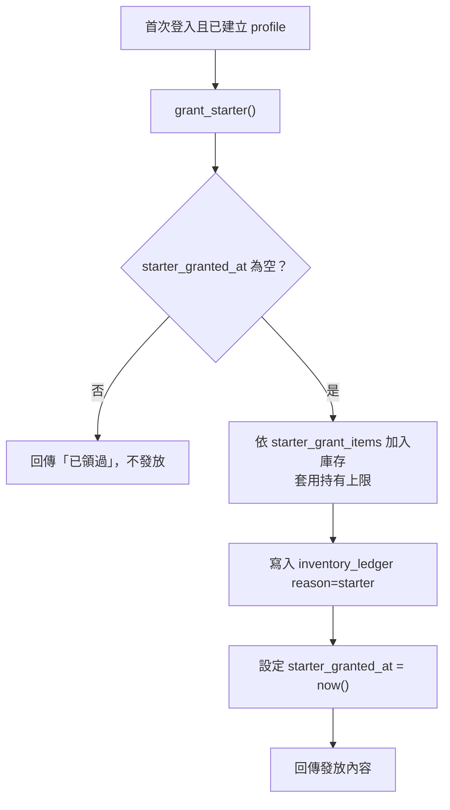

# 05｜初始元素與每日領取規則

## 1. 初始元素

### 已確認

- 新玩家依「測試法鬥配方」獲得初始元素。
- 元素種類由選定的測試配方決定。
- 初始元素必須足以完成**至少一個**配方，玩家才能開始遊玩。
- 數量放在 `starter_grant_items` 資料表，可調整，不寫死在畫面程式。

### 發放機制（設計）



整個流程在單一交易中完成，連按兩次也只會發一次。

### 設定時的自動檢查（Phase 2 建議實作）

匯入或修改 `starter_grant_items` 時，檢查腳本應確認：

- [ ] 至少有一個啟用配方，其所需元素全部能被初始元素滿足。
- [ ] 每項初始數量不超過該元素的 `max_stack`。
- [ ] 列出「只靠初始元素可完成的配方」清單給你確認。

### 待決策

| 編號 | 問題 | 選項 |
|---|---|---|
| D-03a | 初始元素要足以完成幾個配方？ | A. 剛好 1 個（之後靠每日領取）／B. 2～3 個（讓新手快速有成就感）／C. 指定數量 |
| D-03b | 初始元素是否刻意留有「多餘」，讓玩家可失敗幾次？ | A. 不留／B. 留少量容錯／C. 不在意 |
| D-03c | 具體元素數量 | 待你提供測試配方後，我會依 a、b 的選擇列出建議表讓你確認 |

## 2. 每日領取

### 已確認

- 每天一次，簡易領取頁。
- 由伺服器判定資格並記錄。
- 同一天重複點擊不能重複領取。
- 不設體力。

### 「遊戲日」計算方式（設計）

```
遊戲日 = date( 伺服器現在時間 轉換到 daily_reset_timezone − daily_reset_hour 小時 )
```

示範：時區 `Asia/Taipei`、重置時間 5 點 → 台灣時間 11/2 04:59 仍算 11/1，05:00 起算 11/2。（時區與時間為示範，待 D-05。）

`daily_claims` 以 (`user_id`, `claim_day`) 為主鍵，`INSERT ... ON CONFLICT DO NOTHING`；沒有插入成功即代表今日已領，資料庫層面保證不會重複。

### 領取頁顯示狀態

| 狀態 | 畫面 |
|---|---|
| 今日可領 | 顯示領取按鈕（內容是否預告待 D-04c） |
| 處理中 | 按鈕停用、顯示讀取中 |
| 已領取 | 顯示「明天 ‹重置時間› 再來」與倒數 |
| 部分超過上限 | 依 D-02 顯示被捨棄或暫存的數量 |
| 離線 | 提示需要連線才能領取 |

### 待決策

| 編號 | 問題 | 選項 |
|---|---|---|
| D-04a | 每日內容是固定的還是隨機？ | A. 固定清單／B. 從清單隨機抽 N 種（由伺服器抽）／C. 固定＋少量隨機 |
| D-04b | 數量 | 待配方確定後提出建議表 |
| D-04c | 領取前是否預告內容？ | A. 預告／B. 領取後才揭曉 |
| D-04d | 錯過的天數是否補領？ | A. 不補（建議，最單純）／B. 可補最多 N 天 |
| D-05 | 重置時區與時間 | A. 台灣時間 00:00／B. 台灣時間 05:00（避免半夜跨日爭議）／C. 其他 |

## 3. 持有上限（初始、每日共用）

所有入帳都使用同一條規則：`入帳後數量 = min(原數量 + 增加量, max_stack)`，被截掉的部分記在 `inventory_ledger.overflow`。

超出部分的處理方式（D-02）：

| 選項 | 說明 | 優點 | 缺點 |
|---|---|---|---|
| A. 直接捨棄 | 超出就消失，預覽畫面先告知 | 最簡單、規則清楚 | 玩家可能覺得浪費 |
| B. 暫存信箱 | 放進「待領取」區，庫存有空位再領 | 不浪費 | 多一個系統、多一張表 |
| C. 領取前阻擋 | 若會超出就禁止領取／要求先消耗 | 不浪費、不必多系統 | 每日領取可能卡住；合併不適用 |
| D. 第一版上限設得夠高 | 實務上不太會超出，仍以 A 兜底 | 體驗好、實作簡單 | 上限失去調節作用 |
