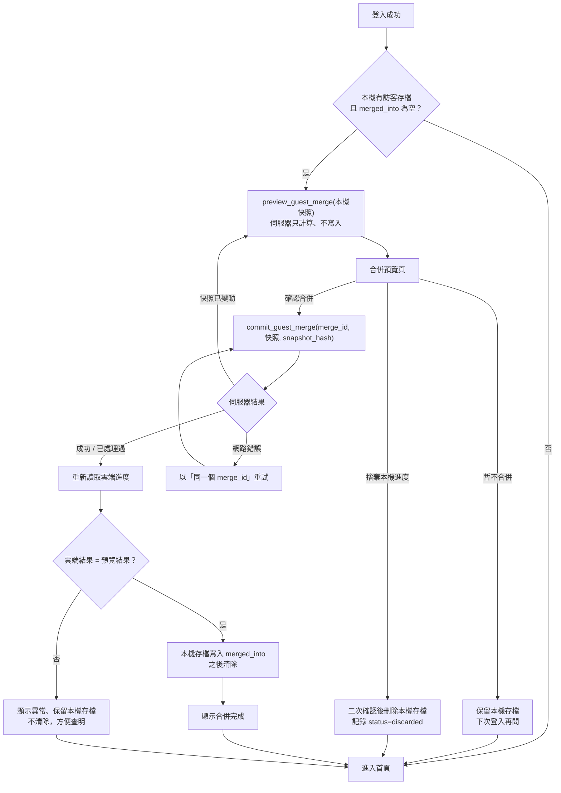

# 06｜訪客與雲端進度合併流程及衝突處理

> ## ⛔ 已取消（D-24 選 A：訪客純試玩、沒有進度）
> 登入合併功能不會實作。本文件保留作為決策紀錄，**以下內容不再適用**。

## 1. 已確認規則

- 訪客進度只存在本機，不提供雲端復原。
- 登入後**先預覽差異，玩家確認後才合併**。
- 元素：`合併後數量 = min(訪客數量 + 雲端數量, 持有上限)`。
- 已收集法鬥、已發現配方：取聯集，不重複計數。
- 合併後必須重新讀取雲端資料驗證。
- 必須防止重複提交造成材料或收藏重複增加。

## 2. 流程圖

## 3. 預覽畫面內容

| 區塊 | 顯示 |
|---|---|
| 元素 | 每種元素一列：訪客數量、雲端數量、相加、上限、**合併後**、**超出未保留** |
| 法鬥收藏 | 新增的角色（剪影或名稱，依 D-10）／雙方都有的角色 |
| 已發現配方 | 新增數量（不顯示配方內容） |
| 暱稱 | 依 D-13 顯示衝突與選擇 |
| 超出上限說明 | 依 D-02 清楚寫出「會捨棄 X 個」或「會放入暫存」 |
| 按鈕 | 確認合併／暫不合併／捨棄本機進度 |

示範（數字只為說明）：上限 20、訪客 8、雲端 15 → 合併後 20，超出 3。

## 4. 重複提交與競態防護

| 風險 | 防護 |
|---|---|
| 連按確認兩次 | 前端按下即停用按鈕；伺服器以 `merge_id` 為主鍵，第二次呼叫直接回傳第一次結果 |
| 網路中斷後重試 | 重試必須使用**同一個** `merge_id` |
| 兩個分頁同時合併 | `guest_merges` 的 UNIQUE (`user_id`, `guest_device_id`)；函式開頭鎖定該玩家的 `profiles` 列 |
| 預覽後本機資料又變動 | 確認時重新計算快照雜湊，與預覽的 `snapshot_hash` 不符就退回重新預覽 |
| 預覽後雲端資料變動（另一裝置製造） | 合併時以**當下**雲端數量重新計算並回傳實際結果；與預覽不同時在完成畫面標示差異 |
| 同一份存檔合併到兩個不同帳號 | 依 D-13d 決定是否允許；本機 `merged_into` 至少能阻擋同裝置重複合併 |

## 5. 防作弊說明（與 D-12 相關，請務必閱讀）

訪客資料存在玩家手機上，**技術上可以被修改**。若伺服器完全信任本機存檔，有心人可以：

- 把元素數量改大 → 合併時最多只能到上限（上限本身就是防線）。
- 把未解鎖角色加進收藏 → 合併後就能取得**正式插畫**，等於繞過私有圖片保護。

因此 D-12 的選擇會直接決定合併時伺服器可以相信什麼：

| D-12 選項 | 合併時元素 | 合併時收藏 |
|---|---|---|
| A. 匿名帳號（訪客其實在雲端） | 不需要「合併」，改為「綁定 Email」；登入既有帳號時才合併，且資料本來就在伺服器上，完全可信 | 完全可信 |
| B. 本機遊玩＋伺服器簽章 | 只接受有簽章的領取與製造紀錄 | 只接受有伺服器簽章的收藏 |
| C. 本機遊玩、合併時完全信任 | 套用上限 | 可被偽造 → 正式插畫保護失效 |
| D. 訪客只能試玩、不能製造正式角色 | 只合併元素（套上限） | 訪客沒有收藏，不需合併 |

## 6. 其他資料類型的衝突處理（待決策 D-13）

| 編號 | 資料 | 選項 |
|---|---|---|
| D-13a | 暱稱 | A. 保留雲端／B. 預覽頁讓玩家選／C. 雲端為空時才用訪客的 |
| D-13b | 製造歷史 | A. 不合併（訪客歷史只留本機）／B. 合併為 `source=guest_merge` 的紀錄／C. 只合併成功紀錄 |
| D-13c | 首次解鎖時間（雙方都有同一角色） | A. 取較早／B. 保留雲端 |
| D-13d | 同一份訪客存檔可否合併進第二個帳號 | A. 不可（建議）／B. 可以 |
| D-13e | 合併後本機存檔 | A. 立即刪除／B. 保留唯讀備份 N 天 |
| D-17a | 訪客已領初始元素，又登入**新**帳號 | A. 新帳號不再發初始元素（以訪客的為準）／B. 兩者都給，靠上限截斷 |
| D-17b | 訪客今天已領每日補給，雲端帳號今天也領過 | A. 只算一次（捨棄訪客當日補給）／B. 相加後套上限 |
| D-17c | 衝突紀錄是否保存 | A. 保存在 `guest_merges.result`（建議）／B. 不保存 |
